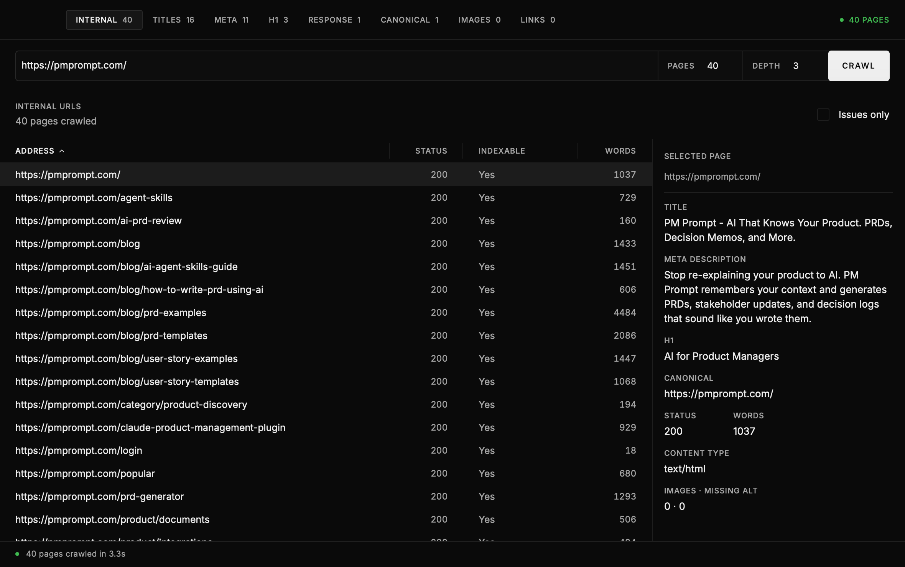
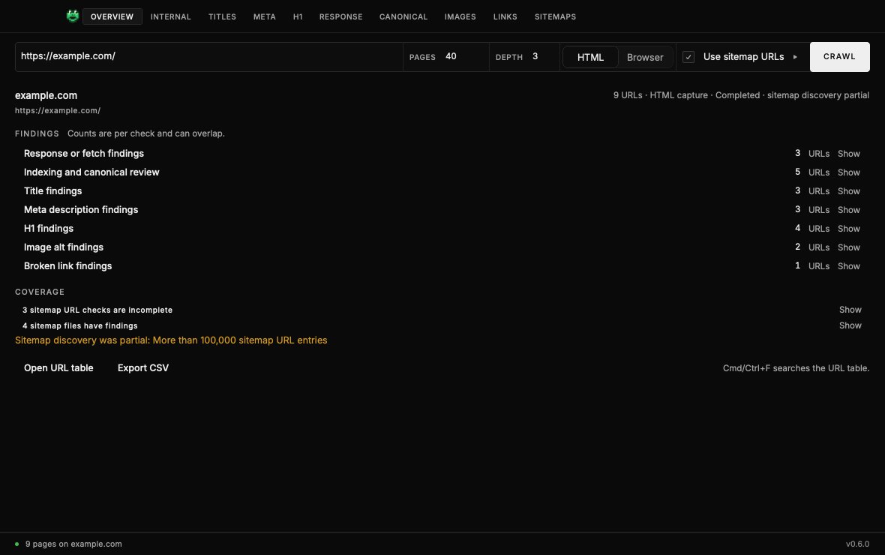

# Calm Toad

Calm Toad checks a website for common problems like missing page titles, broken links, and images without descriptions.

[](https://cdn2.48web.com/assets/frogvtoad%202026-11-10%20at%2013.40.39.mp4)

[Watch the side-by-side demo](https://cdn2.48web.com/assets/frogvtoad%202026-11-10%20at%2013.40.39.mp4) · [Calm Toad website source on GitHub](https://github.com/abrudtkuhl/calmtoad-website)

## Install Calm Toad

The easiest way to install Calm Toad is to ask an AI assistant that can use your computer. Copy and paste this:

```text
Please install Calm Toad on this computer for me. Use the official download for my computer:

- Windows: https://github.com/abrudtkuhl/calmtoad/releases/latest/download/Calm-Toad-Windows.zip
- Mac with an Apple chip: https://github.com/abrudtkuhl/calmtoad/releases/latest/download/Calm-Toad-Mac-Apple-Silicon.zip
- Mac with an Intel processor: https://github.com/abrudtkuhl/calmtoad/releases/latest/download/Calm-Toad-Mac-Intel.zip
- Linux: https://github.com/abrudtkuhl/calmtoad/releases/latest/download/Calm-Toad-Linux.tar.gz

Figure out which link matches this computer. If you are unsure, ask me before downloading. Install Calm Toad in the usual place for apps and open it to make sure it works. Ask me before using an administrator password or changing security settings. If something gets in the way, explain it in plain language. When you're done, tell me where Calm Toad is and confirm that it opened.
```

### Install it yourself

**Windows:** [Download Calm Toad for Windows](https://github.com/abrudtkuhl/calmtoad/releases/latest/download/Calm-Toad-Windows.zip). In Downloads, right-click the file, choose **Extract All**, open the new folder, and double-click **Calm Toad**.

**Mac:** Choose the [Apple chip download](https://github.com/abrudtkuhl/calmtoad/releases/latest/download/Calm-Toad-Mac-Apple-Silicon.zip) for an M-series Mac, or the [Intel download](https://github.com/abrudtkuhl/calmtoad/releases/latest/download/Calm-Toad-Mac-Intel.zip). If you are unsure, open the Apple menu and choose **About This Mac**. Open the download, open the **Calm Toad** folder it creates, then drag **Calm Toad.app** into Applications.

**Linux:** [Download Calm Toad for Linux](https://github.com/abrudtkuhl/calmtoad/releases/latest/download/Calm-Toad-Linux.tar.gz). Open the download, choose **Extract**, then open the new folder and double-click **Calm Toad**. If Linux asks whether to run or display it, choose **Run**. If it does not open, use the instructions above to ask an AI assistant to set it up.

The Mac app is not signed by Apple yet, so macOS may show a security warning the first time you open it. If you choose to continue, follow [Apple's instructions](https://support.apple.com/en-us/102445).

### Updates

Calm Toad checks for a new version when it opens and every 24 hours after that.
When one is available, a strip offers the download; nothing installs until you
choose **Restart and install**, so an active crawl is never interrupted.
Downloads are verified against a signed manifest before they are used. If Calm
Toad lives somewhere it cannot write to (or macOS is running it from a temporary
location), it explains that instead of installing.

Versions installed before this updater existed need one manual upgrade. After
that, updates are handled inside the app. You can also choose **Check for
Updates…** from the app menu at any time.

To try it, open Calm Toad, enter `https://pmprompt.com/`, and press **Crawl**.

The **Links** tab has **Pages** and **Link evidence** views. Link evidence keeps every observed anchor occurrence, including repeated destinations, fragments, invalid schemes and links skipped by robots or budgets. Turn on **Check external links and documents** in the crawl options disclosure to check external anchors and document downloads such as PDFs without downloading their contents or crawling further. Checks are bounded and respect robots.txt and per-origin pacing; a restricted or rate-limited response is labeled as such, not guessed as deleted.

**Overview** shows finding groups and coverage for the current crawl. Open a group to review matching URLs in its table, or choose **Open URL table** to inspect all captured pages. Incomplete checks and sitemap discovery problems remain visible alongside confirmed findings.



Leave **Use sitemap URLs** on and Calm Toad also adds URLs from sitemap files to the crawl. It uses the `Sitemap:` declarations in robots.txt; if there are none, it tries `/sitemap.xml` and then `/sitemap_index.xml`. A guessed file that is missing is not reported as a problem, but a declared sitemap that fails is. URLs from a sitemap join the crawl as entry points and share its page limit, so a large sitemap does not quietly crawl forever. Turning **Use sitemap URLs** off still follows page links and respects robots.txt rules.

The **Sitemaps** tab shows the URLs the sitemaps list and the files that were read. Switch between **URLs** and **Files** above the table. Each URL says whether it was checked, blocked by robots.txt, skipped, or left by the page limit, and checked URLs carry the same response, canonical, and noindex findings as the other tabs. **Findings** narrows either view to rows that need attention.

By default Calm Toad reads the HTML the server sends without running JavaScript. Choose **Browser** in the command bar to render each page in a Chrome or Chromium that is already installed on your computer before auditing it. Browser mode uses a temporary profile of its own, leaves the browser sandbox and certificate checks on, renders at most two pages at a time, and gives each page 15 seconds to load. It never downloads a browser or attaches to your everyday browser profile, and the machine must already have Chrome or Chromium installed. Use **Choose browser…** to select an application; on macOS the picker starts in Applications and accepts the browser’s `.app` directly. The choice is remembered between launches. If the browser cannot start, use **Retry**, **Choose browser…**, or **Use HTML**; raw diagnostics are available under **Details**. HTML remains the default and needs no browser.

Browser mode applies the same host, robots.txt, page and depth limits, sitemap seeding, and redirect rules as an HTML crawl. It audits the rendered document for titles, descriptions, headings, links, and image alt text. The drawer and CSV also keep the capture provenance: whether the source HTML, the rendered DOM, or both were captured, the browser version, request count, elapsed time, the URL the browser actually observed when it differs from the requested one, and any navigation that was refused or queued for another page. Robots and canonical declarations are labeled with the capture stage that produced them, so a source `noindex` that a script removes stays visible as source evidence while a rule still present after rendering is labeled as rendered.

A render that times out, is blocked, or is cut short is reported as an incomplete capture, not as a clean page: its indexability reads Not assessed or keeps a stronger finding, and its row, drawer, and CSV say what was missing. Browser mode never quietly repeats a failed job as HTML and calls it rendered.

The **Internal** tab answers a narrower question than “is this indexed?”: **what did this crawl observe that may prevent or discourage indexing, and where did the signal come from?** The **INDEXABILITY** column uses one of eight labels: Fetch failed, HTTP error, Redirect, Noindex, Review canonical, Canonical elsewhere, Not assessed, or No indexing block detected. A noindex rule is a hard signal, while a canonical pointing elsewhere, a redirect, or incomplete evidence is an advisory. Not assessed means the HTML check did not apply or could not complete, for example a successful PDF, a 304, or a body cut off at the size limit. A plain successful non-HTML response is context, not an issue: it stays out of Findings and sitemap issue counts, while the drawer, CSV, and Sitemaps row still explain why it was not assessed. No indexing block detected means the supported checks found no noindex directive or canonical issue; Google may still choose a different canonical or leave the URL out of its index.

Select a row to open the page details drawer. It lists every finding and its source, the raw robots meta and `X-Robots-Tag` declarations, each canonical declaration with its resolved target and whether that target was fetched or left unchecked, and the read state. Robots rules are applied only when they are generic or scoped to Googlebot; other agent rules stay visible but are marked as scoped. When more directives or canonicals were present than the evidence cap retains, the drawer, CSV, and Sitemaps evidence say so, and an applicable noindex or nofollow in the omitted tail still decides the label. The Internal **Findings** filter uses the same assessment, so advisories and confirmed issues are included; informational context and clean rows are not.

Use **Export inventory CSV…** from Overview or Internal for one self-contained row per captured URL, or choose **Visible Internal URLs** to use that table's saved search, filter and sort. The export can run during a crawl: it uses a labeled immutable snapshot and prepares the CSV in the background. The inventory includes response, capture, content, indexability, link coverage, snapshot/run context and custom-extraction columns; unknown measurements stay empty rather than becoming zero.

**Custom extraction…** opens up to 20 named CSS-selector rules. Each rule returns normalized **Text** or a literal attribute value, using **First** or **All** matches. Rules are validated, stored locally and frozen into each crawl; **Test on URL** previews one page without crawling further. Browser crawls extract from the rendered DOM and report an unavailable rendered document instead of silently using source HTML.

Use **Export CSV** above the results to save the active tab or Sitemaps view. The file includes the columns and rows currently shown, so the current search, sort, and All/Findings/Incomplete filter are applied. On Internal, the export adds a **CAPTURE** column plus **REASONS** and **EVIDENCE** so the row label can be traced back to the exact declarations. The Sitemaps URLs export also includes **CAPTURE** after **SOURCE**.

## Building or improving Calm Toad

Developers: see [CONTRIBUTING.md](CONTRIBUTING.md) for setup, checks, pull requests, and releases.

For automated installs, the downloads are also available through [GitHub Packages](https://github.com/abrudtkuhl/calmtoad/pkgs/container/calmtoad).
