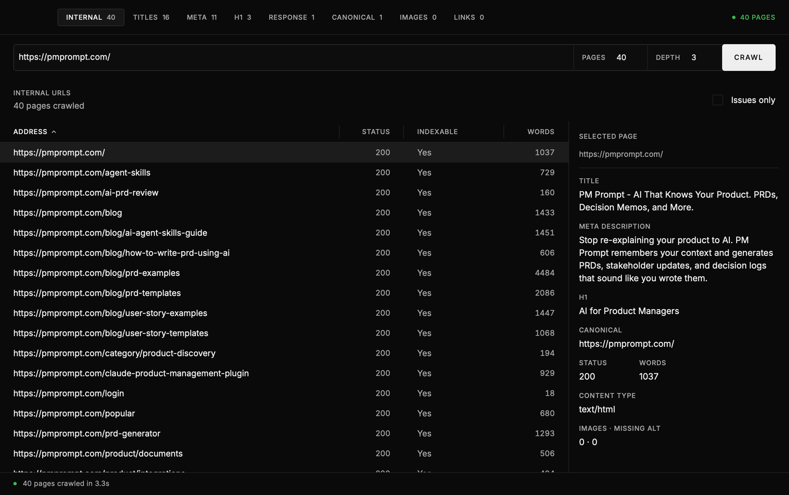

# Calm Toad

Calm Toad checks a website for common problems like missing page titles, broken links, and images without descriptions.

[](https://cdn2.48web.com/assets/frogvtoad%202026-11-10%20at%2013.40.39.mp4)

[Watch the side-by-side demo](https://cdn2.48web.com/assets/frogvtoad%202026-11-10%20at%2013.40.39.mp4) · [Calm Toad website source on GitHub](https://github.com/abrudtkuhl/calmtoad-website)

## Install Calm Toad

The easiest way to install Calm Toad is to ask an AI assistant that can use your computer. Copy and paste this:

```text
Please install Calm Toad on this computer for me. Use the official download for my computer:

- Windows: https://github.com/abrudtkuhl/calmtoad/releases/latest/download/Calm-Toad-Windows.zip
- Mac with an Apple chip: https://github.com/abrudtkuhl/calmtoad/releases/latest/download/Calm-Toad-Mac-Apple-Silicon.zip
- Mac with an Intel processor: https://github.com/abrudtkuhl/calmtoad/releases/latest/download/Calm-Toad-Mac-Intel.zip
- Linux: https://github.com/abrudtkuhl/calmtoad/releases/latest/download/Calm-Toad-Linux.tar.gz

Figure out which link matches this computer. If you are unsure, ask me before downloading. Install Calm Toad in the usual place for apps and open it to make sure it works. Ask me before using an administrator password or changing security settings. If something gets in the way, explain it in plain language. When you're done, tell me where Calm Toad is and confirm that it opened.
```

### Install it yourself

**Windows:** [Download Calm Toad for Windows](https://github.com/abrudtkuhl/calmtoad/releases/latest/download/Calm-Toad-Windows.zip). In Downloads, right-click the file, choose **Extract All**, open the new folder, and double-click **Calm Toad**.

**Mac:** Choose the [Apple chip download](https://github.com/abrudtkuhl/calmtoad/releases/latest/download/Calm-Toad-Mac-Apple-Silicon.zip) for an M-series Mac, or the [Intel download](https://github.com/abrudtkuhl/calmtoad/releases/latest/download/Calm-Toad-Mac-Intel.zip). If you are unsure, open the Apple menu and choose **About This Mac**. Open the download, open the **Calm Toad** folder it creates, then drag **Calm Toad.app** into Applications.

**Linux:** [Download Calm Toad for Linux](https://github.com/abrudtkuhl/calmtoad/releases/latest/download/Calm-Toad-Linux.tar.gz). Open the download, choose **Extract**, then open the new folder and double-click **Calm Toad**. If Linux asks whether to run or display it, choose **Run**. If it does not open, use the instructions above to ask an AI assistant to set it up.

The Mac app is not signed by Apple yet, so macOS may show a security warning the first time you open it. If you choose to continue, follow [Apple's instructions](https://support.apple.com/en-us/102445).

To try it, open Calm Toad, enter `https://pmprompt.com/`, and press **Crawl**.

## Building or improving Calm Toad

Developers: see [CONTRIBUTING.md](CONTRIBUTING.md) for setup, checks, pull requests, and releases.

For automated installs, the downloads are also available through [GitHub Packages](https://github.com/abrudtkuhl/calmtoad/pkgs/container/calmtoad).
